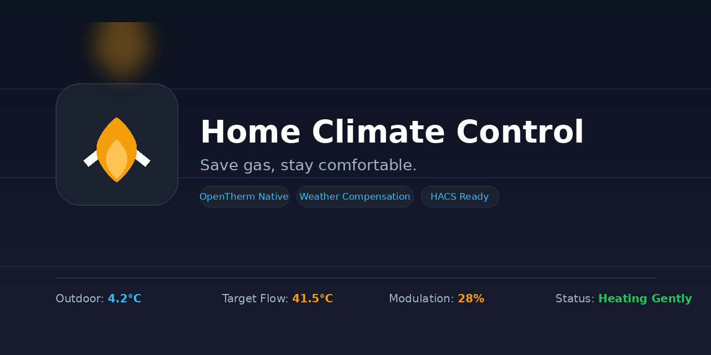
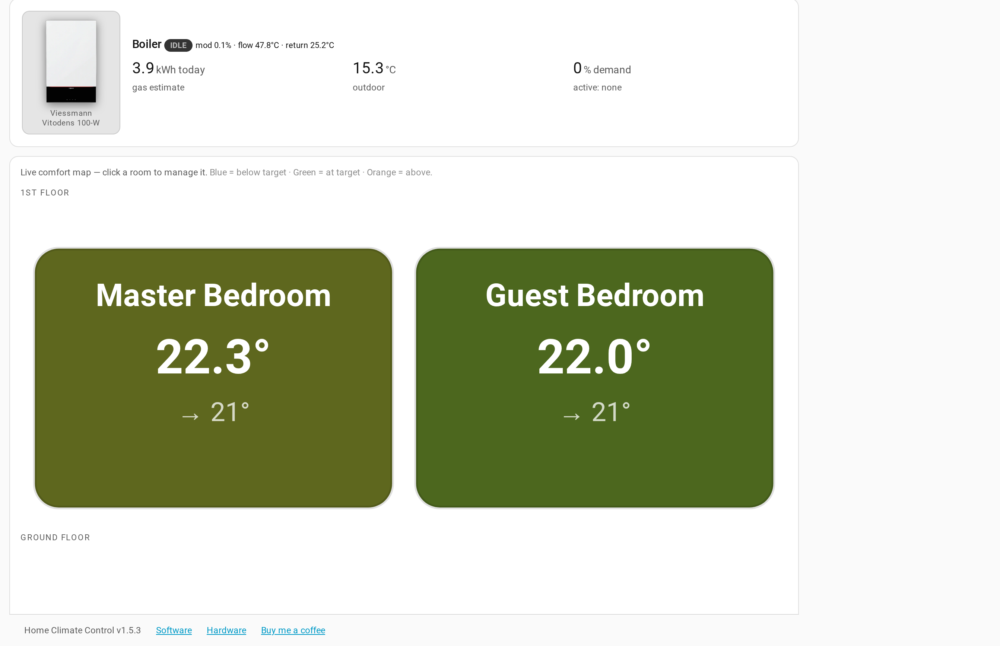
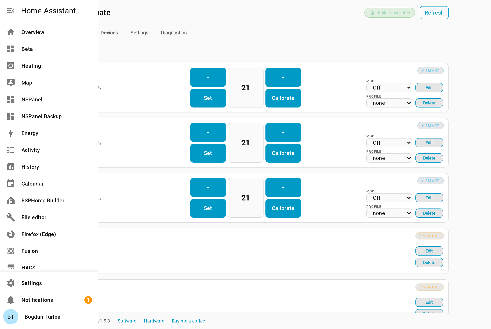
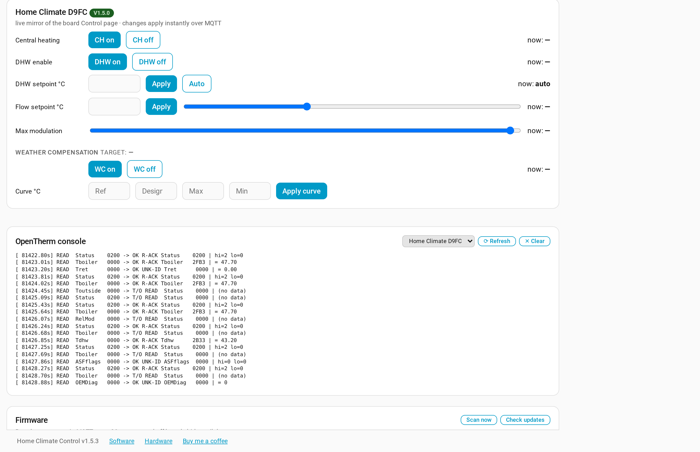
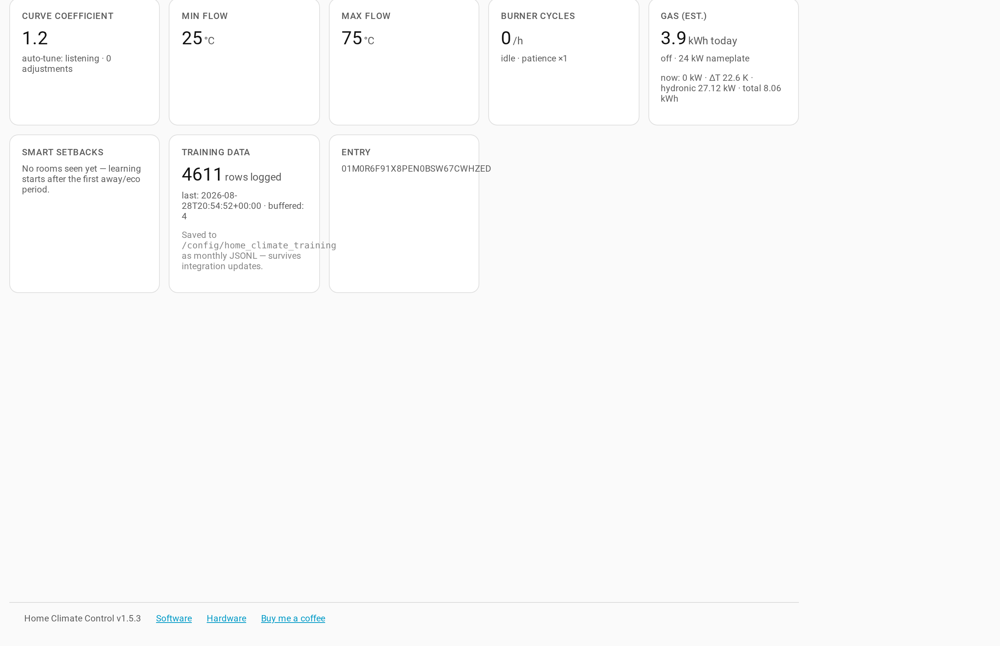

<p align="center">
  
</p>

# Home Climate Control

**Multi-zone heating control for Home Assistant** — weather-compensated,
OpenTherm-native, and gentle on the gas bill.


Companion hardware + firmware: **[home-climate-system](https://github.com/ALeXXBody/home-climate-system)**
— an ESP32/ESP8266 board that speaks OpenTherm to the boiler directly, so no
extra gateway box is needed.

| | |
|---|---|
| **Repo** | https://github.com/ALeXXBody/home-climate-control |
| **Current version** | **v1.32.0** |
| **Companion firmware** | [HCS v1.5.32](https://github.com/ALeXXBody/home-climate-system/releases/tag/v1.5.32) |
| **Minimum Home Assistant** | 2026.10 (Marketplace install: 2026.11+) |
| **Domain** | `home_climate_control` |
| **License** | MIT |

## Naming

| Name | What it is |
|---|---|
| **Home Climate Control (HCC)** | This repository — the Home Assistant integration and its sidebar app |
| **Home Climate System (HCS)** | The ESP32/ESP8266 firmware and OpenTherm hardware ([separate repo](https://github.com/ALeXXBody/home-climate-system)) |

**Control is the software, System is the metal.** The integration holds every
room, schedule and learning rule; the board only speaks OpenTherm.

## Screenshots

| | |
|---|---|
|  |  |
|  |  |

Live data, captured from the sidebar app.

## Features

### Control core

- **Weather-compensated heating curve** — flow follows the outdoor temperature;
  the lowest workable curve wins
- **Outdoor source priority** — boiler outdoor sensor → HA sensor or weather
  entity → last known boiler reading
- **Auto-tuned curve** — the coefficient converges on your house, bounded and
  backed off when it rails
- **PID flow boost** with anti-windup when rooms lag
- **Per-room demand** — only rooms below target call for heat, each with its own
  TRVs, setpoint, profile and window sensors
- **Learned setbacks** — night/away depth sized per room from real recovery speed
- **Dead-time learning + optimal start** — `lead = dead_time + deficit / warm_rate`,
  so rooms are warm on time without a catch-up burn
- **Low-load duty cycling** — pulses the burner in long slices when demand is
  below the boiler's minimum modulation
- **CycleGuard** — adaptive burner rest, minimum-on floor, and command-vs-telemetry
  reconciliation
- **Condensing pull-down** — trims flow when the return climbs above ~54 °C
- **Auto flow cap** — trims the flow ceiling when the return stays hot
- **Wind trim and solar trim** — bounded corrections for infiltration and solar gain
- **Open-window detection** — contact sensors, or a temperature-slope fallback
  when there are none
- **Load-aware health flags** — patience scales with outdoor load
- **Bootstrap calibration** — one click measures °C/h warm-up and seeds the learner
- **Insulation score, CO₂ flag, radiator metering, TRV balancing**
- **Per-room humidity and temperature-trend tracking**
- **Training-data logger** — minute JSONL under `<config>/home_climate_training/`,
  outside the integration folder so updates cannot wipe it

### Rooms and house model

- **Floors**, so rooms group and render per storey
- **Four heater modes** — smart TRV, valve direct, floor, manual (observe-only)
- **Multiple TRVs per room**, each read and written
- **Add, edit and remove rooms** from the panel; every save is backed up and
  every restore is sanitised
- **Battery chips** — 🔘 for the TRV, 🌡 for the room sensor, weakest wins,
  `≤ 20 %` flagged low, nothing shown when no device reports a level

### Learning (shadow mode)

- **Per-room model** that learns how each room responds
- **Shadow only** — it observes and scores, and never controls until you promote it
- **Scorecards and rollback**, with visible skip reasons when data is thin

### Schedules and occupancy (optional)

- **HA schedule → profiles** — `schedule.*`, `input_select.*` or `sensor.*` drives
  room profiles; manual overrides stay until the next window
- **Phone occupancy** — opt-in `device_tracker` / `person` / presence sensors;
  all away → away profile, anyone home → home profile or the live schedule

### Metering, statistics and diagnostics

- **Estimated gas** — modulation × time, or flow/return ΔT when modulation is
  missing, with a calibration multiplier
- **Statistics tab** — daily gas, cost, heat demand and outdoor buckets, 30-day
  trend and bar charts, gas-vs-outdoor scatter
- **Setup analyser** — every capability ticked against the real hardware and
  configuration, in plain language
- **Curve chart** — the last 24 h of operating points on the curve
- **Debug tab** — live event feed and a per-room TRV state table

### Boards and firmware

- **One app, one board** — explicit binding; no automatic adoption
- **HTTP-primary telemetry** — polls the board's portal every 60 s, with MQTT as
  the fast secondary feed, plus a deaf-hub self-heal and a 15-minute notification
- **Device tab** — one compact linked-board view mirroring the board's own page
- **Two-way settings sync** with the firmware
- **Firmware updates** — GitHub catalog, LAN mirror with signature verification,
  push OTA, and pull-based self-update on newer firmware
- **Honest version footer** — the running version, HA uptime, and a
  `code not loaded — restart HA` badge when the files are newer than the process

## Requirements

- Home Assistant **2026.10** or newer
- The built-in **Marketplace** (Home Assistant 2026.11+; HACS has been folded into it)
- MQTT configured in Home Assistant
- A **Home Climate System** board ([repo](https://github.com/ALeXXBody/home-climate-system))
- An outdoor temperature source: the boiler's sensor, or an HA sensor/weather entity

## Install via Marketplace

1. **Settings → Marketplace** → search **Home Climate Control** → **Install**
2. **Settings → Devices & services → + Add integration** → Home Climate Control
   - HCS: MQTT prefix + node id, flow limits, curve
   - Or **Demo mode** (no hardware)

If the catalog copy is not visible yet, add
`https://github.com/ALeXXBody/home-climate-control` as a custom repository in
Marketplace (category **Integration**).

Full steps, firmware flashing and wiring: **[Installation](https://github.com/ALeXXBody/home-climate-control/wiki/Installation)**.

## Configure

Everything is editable in the app: **Home Climate → Settings**.

| Card | Options |
|---|---|
| Curve & flow limits | Coefficient, min/max flow, auto-tune |
| Outdoor & wind | Outdoor fallback, wind trim, weather entity, trim cap |
| Low-load behaviour | Boiler minimum modulation %, duty cycling |
| Schedule | Schedule entity, on/off profiles |
| Occupancy (phones) | Enable, presence entities, away/home profiles |
| Gas metering | Nameplate kW, minimum kW, nomod factor, calibration, price |
| Auto-Optimize | Master gate for every optimizer that writes |
| Preset temperatures | The absolute temperature behind each profile |
| Your boiler | Make and model selection |
| Connection-loss failsafe | Enable, flow, grace period |
| Self-learning | Training, scorecards, promotion |

Every option is described in
**[Options and settings](https://github.com/ALeXXBody/home-climate-control/wiki/Options-and-settings)**.

## Update

**Settings → Marketplace → Home Climate Control → Update** → restart Home
Assistant → hard-refresh the sidebar panel (Ctrl+Shift+R).

Updates load only after a full restart; the footer warns when the files on disk
are newer than the running code.

## Sidebar app

| Tab | What it is for |
|---|---|
| **Home** | Outdoor, flow, demand, gas, room summary and the floor plan |
| **Rooms** | Room cards, add/edit rooms, calibration |
| **Statistics** | Daily gas, cost, heat demand and outdoor history |
| **Device** | The linked board: its control page, settings and firmware |
| **Settings** | Integration options and self-learning |
| **Diagnostics** | Setup analyser, curve, burner cycles, setbacks, schedule, occupancy |
| **Debug** | Live event feed and TRV state table (hidden by default) |

## Status

- Backends: demo · native HCS (HTTP portal + MQTT)
- Tests: `pytest` in this repo — 622 tests across 75 test modules
- Tested hardware: Viessmann Vitodens 100-W B1KF, DIYLess Master/Slave OT
  shields, LOLIN C3 mini v2.1, ESP8266 D1 mini, LOLIN S2 mini

## Run tests

```bash
python3 -m venv .venv && source .venv/bin/activate
pip install -r requirements-dev.txt
pytest -q
```

## Docs

- **[Wiki](https://github.com/ALeXXBody/home-climate-control/wiki)** —
  [Installation](https://github.com/ALeXXBody/home-climate-control/wiki/Installation) ·
  [Quick start](https://github.com/ALeXXBody/home-climate-control/wiki/Quick-start) ·
  [Configuration](https://github.com/ALeXXBody/home-climate-control/wiki/Configuration) ·
  [Options and settings](https://github.com/ALeXXBody/home-climate-control/wiki/Options-and-settings) ·
  [Using the panel](https://github.com/ALeXXBody/home-climate-control/wiki/Using-the-panel) ·
  [Gas optimization](https://github.com/ALeXXBody/home-climate-control/wiki/Gas-optimization) ·
  [Learning and setbacks](https://github.com/ALeXXBody/home-climate-control/wiki/Learning-and-setbacks) ·
  [Schedule](https://github.com/ALeXXBody/home-climate-control/wiki/Schedule) ·
  [Occupancy](https://github.com/ALeXXBody/home-climate-control/wiki/Occupancy) ·
  [Failsafe](https://github.com/ALeXXBody/home-climate-control/wiki/Failsafe-and-CycleGuard) ·
  [FAQ](https://github.com/ALeXXBody/home-climate-control/wiki/FAQ) ·
  [Troubleshooting](https://github.com/ALeXXBody/home-climate-control/wiki/Troubleshooting)
- [Architecture](docs/architecture.md) · [How it works](docs/HOW_IT_WORKS.txt) · [Decision tables](docs/decision-tables.md)
- Firmware: [home-climate-system](https://github.com/ALeXXBody/home-climate-system) · [HCS wiki](https://github.com/ALeXXBody/home-climate-system/wiki)

## Support

[](https://buymeacoffee.com/alexxbody)

## License

MIT — see [`LICENSE`](LICENSE).
